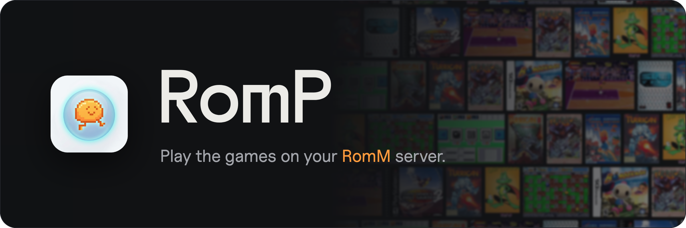
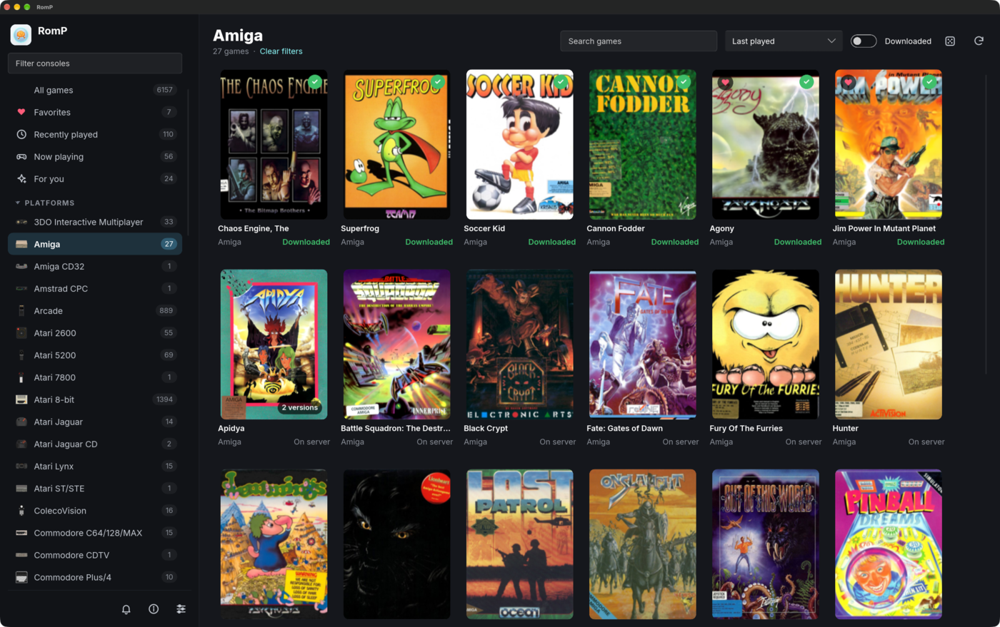
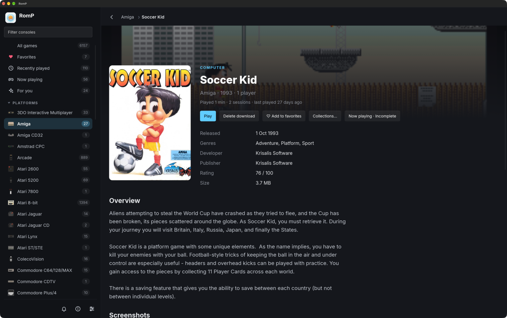
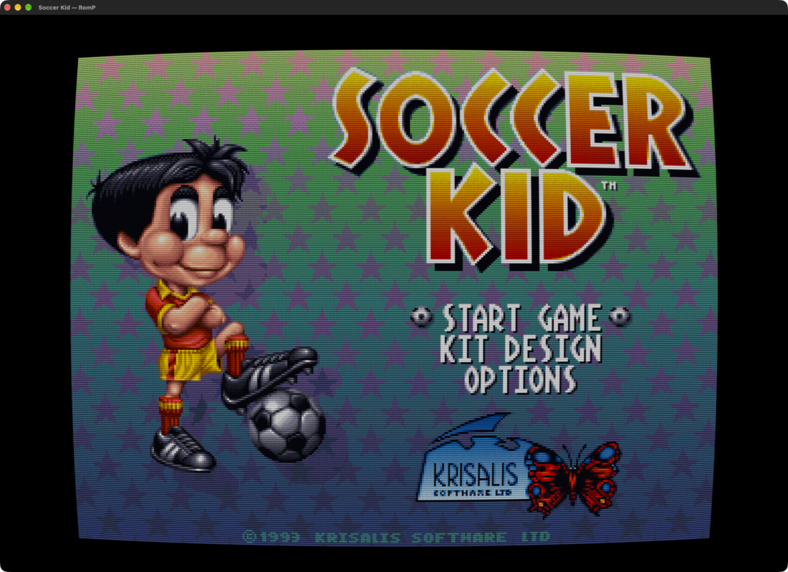
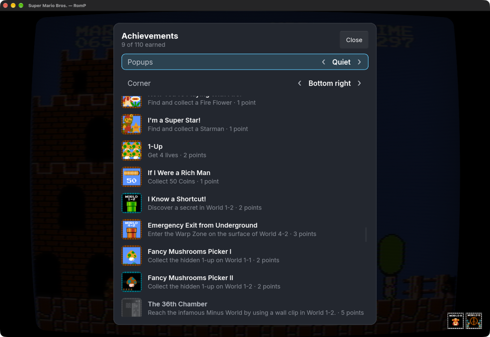
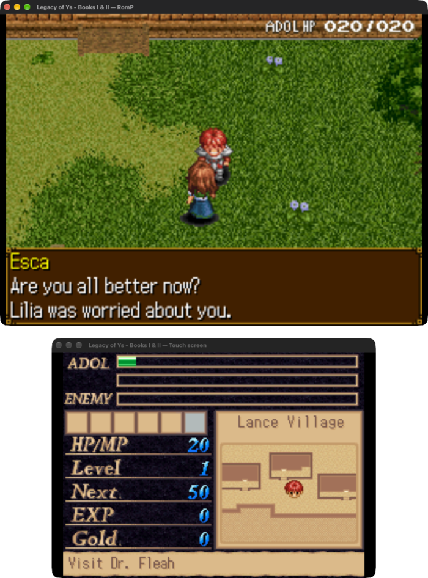
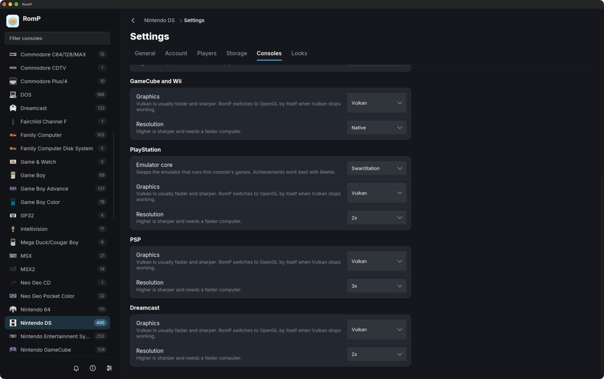

  

  
  
  

  
  
  
  

Play retro games from your <a href="https://romm.app">RomM</a> library, with each game running in its own sandboxed process.

<a href="https://rompemu.github.io">rompemu.github.io</a>

## What you need

A [RomM](https://romm.app) server, version 5.0 or newer. RomM is a program you host yourself that keeps your game collection, with its box art and details, on a computer or server of your own. RomP is the app you play that collection with: it shows your library, downloads a game when you open it, runs it, and keeps your saves in step with the server.

## Install

Get the [latest release](https://github.com/RompEmu/RomP/releases/latest), or the [nightly build](https://github.com/RompEmu/RomP/releases/tag/nightly) for the newest changes.

- **macOS:** download the release, or install it with [Homebrew](https://brew.sh): `brew install --cask rompemu/tap/romp`. Releases are signed and notarized by Apple. Nightly builds aren't: the first time, right-click RomP and choose Open.
- **Windows:** download and unzip the release. Builds aren't signed yet: the first time, choose More info, then Run anyway.
- **Linux:** pick the AppImage, or the .deb (Debian, Ubuntu) or .rpm (Fedora, openSUSE) to install it with the system's other software.

## Getting started

1. Open RomP and enter your RomM server's address.
2. Approve RomP in RomM by scanning the code or opening the link.
3. Open a game from your library. RomP downloads it, installs the emulator it needs, and fetches BIOS files from your server's firmware.

Downloaded games stay playable when the server is offline. In-game saves and save states sync with RomM before and after you play, so you can continue on another device. If a save changed in both places, RomP asks which to keep and backs up the other.

The [questions page](https://rompemu.github.io/faq/) has short answers about what RomP needs, what it plays and how save sync works.

<table>
  <tr>
    <td width="64%" align="center">
      
    </td>
    <td valign="top">
      <b>Your RomM library</b>  
      Every console, favorites, collections, recently played and suggestions, with box art shaped like each console's. A tick marks the games already on this computer.
    </td>
  </tr>
  <tr>
    <td width="64%" align="center">
      
    </td>
    <td valign="top">
      <b>A page for every game</b>  
      Details and screenshots from RomM, your play time, save slots with pictures and achievements, with one button to download and play.
    </td>
  </tr>
  <tr>
    <td width="64%" align="center">
      
    </td>
    <td valign="top">
      <b>Games in their own window</b>  
      Each game runs in its own sandboxed process, with looks that bring back a CRT television or a handheld's screen.
    </td>
  </tr>
  <tr>
    <td width="64%" align="center">
      
    </td>
    <td valign="top">
      <b>RetroAchievements</b>  
      Popups as you earn them, and the full list a button away without leaving the game.
    </td>
  </tr>
  <tr>
    <td width="64%" align="center">
      
    </td>
    <td valign="top">
      <b>Two screens, two windows</b>  
      A Nintendo DS game's screens each get a window you can place and size as you like, with the touch screen played with the mouse.
    </td>
  </tr>
  <tr>
    <td width="64%" align="center">
      
    </td>
    <td valign="top">
      <b>Settings for each console</b>  
      Choose the emulator, Vulkan or OpenGL, and the resolution for each console. Emulators install themselves the first time they're needed.
    </td>
  </tr>
</table>

## Features

- **Everything in your RomM library:** now playing and backlog lists, a For you list of games RomM recommends, search, sorting, and a Surprise me button for a random game.
- **Game versions:** a game with several versions in RomM (regions, revisions, translations) shows once, and its page lets you choose which one to play. Multi-disc games play from one save, with discs changed from the game menu.
- **Saves that follow you:** in-game saves and save states sync with RomM, with a save slot picture for each state.
- **Sandboxed emulators:** emulators are native code downloaded from the internet, and games are files from anywhere. Each game runs in its own locked-down process that can only write to that game's saves and its own temporary files, so a buggy or malicious emulator or ROM can't touch your other files or take RomP down with it. xemu and RPCS3 run outside the sandbox.
- **RetroAchievements:** popups, leaderboards, and an achievement list in the game menu and on each game's page. Hardcore mode comes once RetroAchievements approves RomP, which it considers after an emulator has been public for six months. Only the app talks to RetroAchievements, never the sandboxed emulator.
- **Looks:** each console can be drawn with sharp pixels, a CRT television's glow and scanlines, or a handheld's screen, chosen in the Looks part of Settings or changed live from the game menu.
- **Many systems:** from the Atari 2600 to the PS3 and original Xbox, plus arcade and home computers. See [supported systems](#supported-systems).
- **Choices for each console:** where a console has more than one emulator you pick which one runs it, and for the 3D consoles you choose the resolution and whether to draw through Vulkan or OpenGL.
- **Controllers and multiplayer:** gamepads join as the next player, rumble when the game does, and the whole app works with a controller. Buttons can be remapped, for every console or one at a time.
- **Light guns, mice and keyboards:** for the systems that use them.
- **In-game menu:** pause, restart, save slots, changing discs, looks, volume, screenshots and full screen.
- **Picks up where you left off:** the last console, game and scroll position, and the size and position of every window.
- **Keeps you posted:** RomP tells you when a newer version is out and what's new in it, and shows RomM's notifications, such as a finished library scan, behind a bell in the sidebar (RomM 5.4 or newer).
- **In your language:** French, Spanish, German and Arabic so far, with interface sizes of 1x, 1.5x or 2x.

## Supported systems

RomP downloads the emulator for each system the first time you play one of its games. Where a system has more than one emulator, choose the one it runs on under **Emulator core** in the Consoles part of Settings.

Every system and the emulator that runs it

| System | Emulator |
|---|---|
| Arcade, including Neo Geo and CPS 1–3 | FinalBurn Neo |
| Amstrad CPC | Caprice32 |
| Atari 2600 | Stella |
| Atari 5200 | a5200 |
| Atari 7800 | ProSystem |
| Atari 8-bit computers and XEGS | Atari800 |
| Atari Jaguar and Jaguar CD | Virtual Jaguar |
| Atari Lynx | Beetle Lynx |
| Atari ST | Hatari |
| Bandai WonderSwan and WonderSwan Color | Beetle WonderSwan |
| ColecoVision | Gearcoleco |
| Commodore 64 | VICE x64sc |
| Commodore 128 | VICE x128 |
| Commodore VIC-20 | VICE xvic |
| Commodore Plus/4 and 16 | VICE xplus4 |
| Commodore Amiga, Amiga CD32 and CDTV | PUAE |
| DOS | DOSBox Pure |
| Fairchild Channel F | FreeChaF |
| Intellivision | FreeIntv |
| Magnavox Odyssey 2 | O2EM |
| Mega Duck / Cougar Boy | SameDuck |
| MSX, MSX2 and MSX2+ | blueMSX |
| NEC PC Engine / TurboGrafx-16 | Beetle PCE Fast |
| NEC PC Engine CD / TurboGrafx-CD | Beetle PCE |
| NEC SuperGrafx | Beetle SuperGrafx |
| NEC PC-FX | Beetle PC-FX |
| Nintendo Entertainment System, Famicom and Famicom Disk System | Nestopia UE |
| Super Nintendo and Super Famicom | Snes9x |
| Nintendo 64 | Mupen64Plus-Next |
| Game Boy, Game Boy Color and Game Boy Advance | mGBA |
| Nintendo DS | melonDS DS |
| Nintendo GameCube and Wii | Dolphin |
| Nintendo Virtual Boy | Beetle VB |
| Nintendo Game & Watch | Game & Watch |
| Nintendo Pokémon Mini | PokeMini |
| Philips CD-i | SAME CDi |
| 3DO | Opera |
| Sega Master System, Genesis / Mega Drive, Game Gear, Sega CD and SG-1000 | Genesis Plus GX |
| Sega 32X | PicoDrive |
| Sega Saturn | Beetle Saturn |
| Sega Dreamcast | Flycast |
| SNK Neo Geo CD | NeoCD |
| SNK Neo Geo Pocket and Pocket Color | Beetle NeoPop |
| Sony PlayStation | Beetle PSX HW, or SwanStation |
| Sony PlayStation 2 | PCSX2 on Windows and Linux, [ARMSX2](https://github.com/RompEmu/ARMSX2) on macOS |
| Sony PlayStation 3 | RPCS3 |
| Sony PSP | PPSSPP |
| PICO-8 | [FAKE-08](https://github.com/RompEmu/fake-08) |
| TIC-80 | TIC-80 |
| Vectrex | Vecx |
| Watara Supervision | Potator |
| Microsoft Xbox | xemu |
| ZX Spectrum | Fuse |

All emulators except xemu and RPCS3 are [libretro](https://www.libretro.com) cores. ARMSX2 and FAKE-08 aren't built by libretro, so RomP downloads them from RompEmu's own forks, which build them for each platform. Dolphin, PPSSPP, Flycast, Beetle PSX HW, SwanStation, Mupen64Plus-Next and the PS2 emulators draw through Vulkan when the computer has a working Vulkan driver, and through OpenGL otherwise. Each of them except ARMSX2 can be set to OpenGL instead under **Graphics** in the Consoles part of Settings, and RomP makes that switch itself, and starts the game again, when an emulator's Vulkan graphics stop working. On macOS, Vulkan comes from the bundled [MoltenVK](https://github.com/KhronosGroup/MoltenVK). Some systems need BIOS files, which RomP takes from your RomM server's firmware. PS3 games need the PS3 system software (`PS3UPDAT.PUP`) in RomM's PS3 firmware, and play from a game folder or an ISO, or a zip or 7z of one.

## Controls

- Gamepads are picked up automatically: the first one joins the keyboard as player 1, and each new one becomes the next player.
- Change players or remap any key or button in the Players part of Settings. Buttons can also be set separately for each console.
- The Guide button, or Select and Start together, opens the game menu. The Shortcuts part of Settings can change that to two or three buttons held together, such as L3 + R3, which keeps Guide free for Steam.
- In Amiga, DOS, C64 and ZX Spectrum games the keyboard types into the game and F12 opens the menu. Click in the game to use your mouse; F12 releases it.
- Accessories such as the SNES Mouse, Super Scope, Zapper or GunCon are chosen per port in the game menu. A light gun aims where you point and fires with the left button; the right button reloads.

Default keyboard layout:

| Key | Action |
|---|---|
| Arrow keys | D-pad |
| X, Z, S, A | A, B, X, Y |
| Q, W, D, F | L, R, L2, R2 |
| Enter, Backspace | Start, Select |
| F5, F7 | Save, load state |
| F6 | Next save slot |
| P | Pause |
| F11 | Full screen |
| F12 | Screenshot |
| Esc | Game menu |

Every key except Esc can be changed in the Players part of Settings, and shortcuts can be combinations such as Ctrl+S.

## Your files and logs

Your games, saves and library cache are stored in `~/Library/Application Support/Romp` on macOS, `%LOCALAPPDATA%\Romp` on Windows and `~/.local/share/Romp` on Linux.

The `logs` folder there holds a log of each of the last five launches. Show log in About RomP opens it, and Copy the last game's log puts the most recent game's part on the clipboard.

If something goes wrong, [open an issue](https://github.com/RompEmu/RomP/issues/new/choose) and paste that log.

Your RomM and RetroAchievements sign-ins are kept in the system's keychain. On a computer with none, such as a Steam Deck in game mode, RomP keeps them in a file in its data folder that only your user account can read.

## Free, with no catches

RomP is free and always will be: no paid features, subscriptions, ads, tracking or accounts of its own. Every build has every feature. [PRIVACY.md](PRIVACY.md) lists what RomP sends and where, and the Licenses tab under About RomP lists every emulator it downloads with its license.

## Translations

RomP is translated by the people who use it, on [Crowdin](https://crowdin.com/project/romp). You don't need to know any programming, and a free Crowdin account is enough:

1. Open the [RomP project on Crowdin](https://crowdin.com/project/romp) and choose your language.
2. Translate strings, or vote for the best suggestions others made.
3. New translations reach the app within a day and ship in the next release.

RomP is being translated into French, Spanish, German and Arabic so far. To add another language, [open an issue](https://github.com/RompEmu/RomP/issues).

A few things to keep in mind:

- Keep placeholders such as `{name}` or `{0}` exactly as they are. You can move them anywhere in the sentence.
- Leave names as they are: RomP, RomM, RetroAchievements and console names.
- To see your language in RomP, choose it under Language in the General part of Settings. RomP follows your system's language once it has translations for it.

## Contributing

Bug reports, ideas and pull requests are welcome. [CONTRIBUTING.md](CONTRIBUTING.md) explains how to build RomP, run its checks and send a change. To help translate it, see [Translations](#translations).

## License

RomP is free software: you can redistribute it and/or modify it under the terms of the [GNU General Public License](LICENSE), version 3 or (at your option) any later version.
